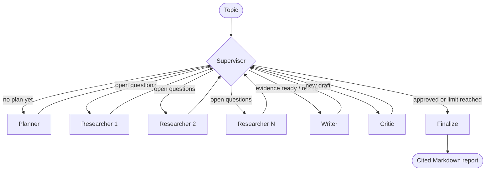

# Multi-Agent Research Assistant

[](https://github.com/sanjay-sss/multi-agent-research-assistant/actions/workflows/ci.yml)


A multi-agent system built with **[LangGraph](https://github.com/langchain-ai/langgraph)** and **Google Gemini** that turns any topic into a well-structured, **cited** research report.

A **Supervisor** agent coordinates a team of specialists. They plan the research, search the web in parallel, write a draft, and critique and revise it until it meets a quality bar.

A real run (about 30 seconds). The resulting report is in [`examples/solid-state-batteries-report.md`](examples/solid-state-batteries-report.md):

```text
$ research-assistant --model gemini-3.5-flash-lite "How are solid-state batteries changing electric vehicles?"

[supervisor] -> planner: No research plan yet.
[planner]    4 research questions:
               1. What are solid-state batteries and how do they differ from lithium-ion batteries in electric vehicles?
               2. What are the current technological advancements and manufacturing challenges of solid-state batteries for electric vehicles?
               3. Which companies and automotive manufacturers are leading the development of solid-state batteries?
               4. What is the projected timeline and market impact of solid-state batteries on the future of electric vehicles?
[supervisor] -> researcher: 4 question(s) need research.
[researcher] What are the current technological advancements and manufacturing challenges of solid-state batteries for electric vehicles?
               5 sources, 3 key facts
[researcher] Which companies and automotive manufacturers are leading the development of solid-state batteries?
               5 sources, 4 key facts
[researcher] What are solid-state batteries and how do they differ from lithium-ion batteries in electric vehicles?
               5 sources, 1 key facts
[researcher] What is the projected timeline and market impact of solid-state batteries on the future of electric vehicles?
               5 sources, 5 key facts
[supervisor] -> writer: Research is complete; write the first draft.
[writer]     draft v1 written (658 words)
[supervisor] -> critic: Draft v1 needs review.
[critic]     score 10/10, approved
[supervisor] -> finalize: Critic approved draft v1 (10/10).
[finalize]   report assembled with sources

Report saved to outputs/how-are-solid-state-batteries-changing-electric-vehicles-20261104-083140.md
```

## Architecture



| Agent | Responsibility | Output |
|-------|----------------|--------|
| **Supervisor** | Decides which agent works next. Uses state-based guardrails, and calls the LLM when there is a real choice (research more vs. revise). | Routing decision + reason |
| **Planner** | Breaks the topic into focused, non-overlapping research questions. | `ResearchPlan` |
| **Researcher** | One instance per question, **run in parallel**. Searches the web and extracts key facts, each tied to the sources it came from. | `Finding` |
| **Writer** | Drafts a themed Markdown report with inline `[n]` citations, and revises it using the critic's feedback. | Draft report |
| **Critic** | Checks accuracy against the evidence, coverage and clarity. Scores the draft and can request follow-up research. | `Critique` |
| **Finalize** | Appends a Sources section built from the real search results. | Final report |

### Design highlights

- **Supervisor pattern with guardrails.** Hard rules decide what is *allowed* next: you can't write before researching, each draft is reviewed once, and the run stops after a maximum number of revisions or research rounds. The LLM decides only between the valid options, so the workflow always terminates.
- **Parallel map-reduce research.** The supervisor fans out one researcher per open question with LangGraph's `Send` API. Their findings merge through an `operator.add` reducer on the shared state.
- **Citations from real sources.** Researchers number their own search results. The evidence layer then remaps every citation to one global numbering and drops duplicate URLs. The final Sources list is generated from actual search results, so the model can't invent URLs, and out-of-range citations are filtered out.
- **Self-correcting loop.** The critic's feedback goes back to the writer. If information is missing, the supervisor can send the team back to research with the critic's follow-up questions.
- **Structured outputs.** Every agent except the writer returns a validated Pydantic model, and the code enforces rules instead of trusting the model. For example, a draft can't be "approved" with a score below the threshold.
- **Resilient to flaky APIs.** Agent steps use LangGraph `RetryPolicy` with exponential backoff, retrying only errors LangChain marks as transient (overload, rate limit, timeout), so a bad key or exhausted daily quota fails fast with a clear message. Web searches are rate-limited, retried, and fall back to a keyword query when a full question finds nothing.
- **Testable by design.** The LLM and search tool are injected, so the whole graph runs offline in tests with a scripted fake LLM.

## Quick start

**Requirements:** Python 3.10+ and a free [Google Gemini API key](https://aistudio.google.com/apikey).

```bash
git clone https://github.com/sanjay-sss/multi-agent-research-assistant.git
cd multi-agent-research-assistant

python -m venv .venv
# Windows:      .venv\Scripts\activate
# macOS/Linux:  source .venv/bin/activate

pip install -e ".[dev]"

cp .env.example .env        # Windows: copy .env.example .env
# then edit .env and set GOOGLE_API_KEY=...
```

> **Free-tier note:** a run makes roughly 8-15 model requests. Gemini's free tier limits requests per model per day, and each model has its own quota. If you hit the limit, switch models with `--model gemini-3.5-flash-lite`, wait for the quota to reset, or enable billing.

## Usage

```bash
research-assistant "The state of quantum computing in 2026"

# or
python -m research_assistant "Impact of AI on healthcare diagnostics"
```

Reports are saved to `outputs/` as Markdown.

| Option | Description |
|--------|-------------|
| `-o, --output-dir` | Where to save reports (default `outputs/`) |
| `--model` | Gemini model to use (overrides `GEMINI_MODEL`) |
| `--max-questions` | Maximum research questions the planner creates |
| `--max-revisions` | Maximum drafts the writer may produce |
| `-q, --quiet` | Only print the output path |
| `--show-graph` | Print the agent graph as a Mermaid diagram and exit |

### Use it from Python

```python
from research_assistant import build_graph

graph = build_graph()
result = graph.invoke({"topic": "Vertical farming economics"}, {"recursion_limit": 100})
print(result["report"])
```

## Configuration

All settings can go in `.env`:

| Variable | Default | Description |
|----------|---------|-------------|
| `GOOGLE_API_KEY` | (required) | Gemini API key |
| `GEMINI_MODEL` | `gemini-3.5-flash` | Model used by every agent |
| `MAX_RESEARCH_QUESTIONS` | `4` | Questions the planner may create |
| `SEARCH_RESULTS_PER_QUESTION` | `5` | Web results fetched per question |
| `MAX_REVISIONS` | `2` | Maximum drafts before publishing |
| `MAX_RESEARCH_ROUNDS` | `2` | Initial research + follow-up rounds |
| `APPROVAL_SCORE` | `8` | Minimum critic score (1-10) to approve |

## Project structure

```text
src/research_assistant/
├── agents/
│   ├── supervisor.py   # routing guardrails + LLM decision, parallel fan-out
│   ├── planner.py      # topic -> research questions
│   ├── researcher.py   # web search -> cited key facts
│   ├── writer.py       # evidence -> Markdown report (and revisions)
│   └── critic.py       # scoring, feedback, follow-up questions
├── graph.py            # LangGraph StateGraph wiring + finalize step
├── state.py            # shared state with reducers
├── schemas.py          # Pydantic models for structured outputs
├── evidence.py         # global citation numbering + Sources section
├── tools.py            # DuckDuckGo web search
├── prompts.py          # system prompts for each agent
├── llm.py              # Gemini model setup
├── config.py           # settings from environment
└── cli.py              # command-line interface
tests/                  # offline tests with a fake LLM and fake search
```

## Testing

```bash
pytest          # runs fully offline: no API key or network needed
ruff check .
```

The tests run the **entire graph end to end** with a scripted fake LLM. They cover the happy path, revision limits, follow-up research rounds, supervisor fallback when a model call fails, empty search results, and citation handling.

## Roadmap

- [ ] Streamlit web UI with live agent activity
- [ ] Human-in-the-loop approval of the research plan (LangGraph `interrupt`)
- [ ] Persistent runs with a SQLite checkpointer (resume after failures)
- [ ] Full-page content extraction for richer evidence
- [ ] LangSmith tracing and evaluation

## License

[MIT](LICENSE)
